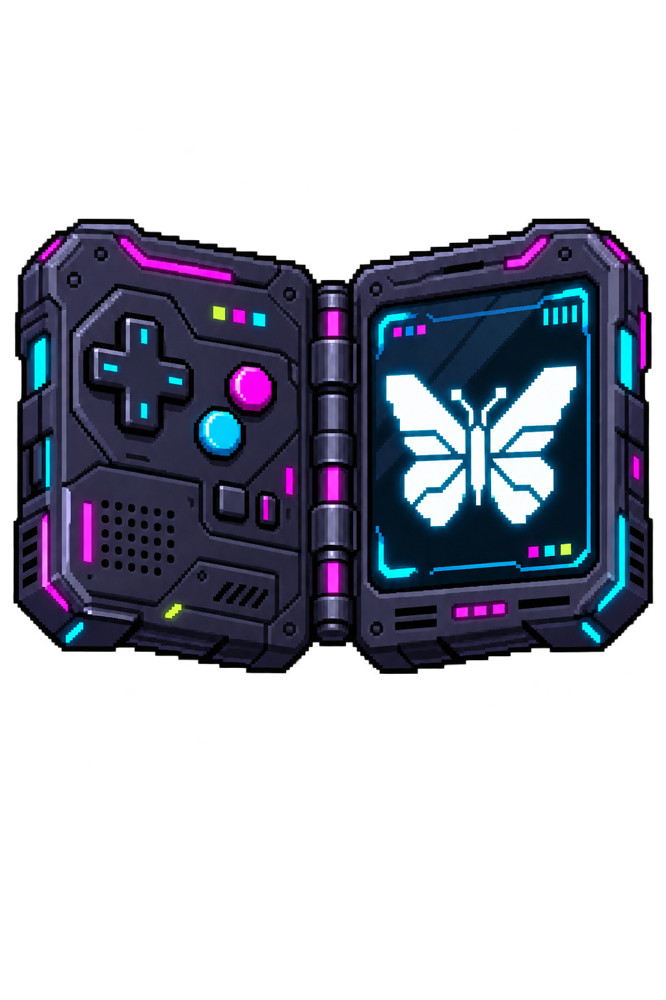

# Bdex — Pokémon collections for Generations 1–3

Available from **v1.2.0** under Tools → Bdex. The optional read-only web viewer
remains off by default.

Bdex is an off-game collection, separate from your game saves. Imports and
exports **copy** Pokémon. They do not remove Pokémon from the source save or
from Bdex. No games, saves, species-name tables or sprites are bundled.

## Open your collection

Open **Tools → Bdex → Gen 1** (Red, Blue, Yellow) or **Gen 2** (Gold, Silver,
Crystal), or **Gen 3** (Ruby, Sapphire, Emerald, FireRed, LeafGreen).
On first use, choose your matching supported English retail ROM to
prepare names and sprites. A ZIP containing one `.gb`, `.gbc` or `.gba` ROM is also supported. Cancelling lets you browse by species
number without preparing artwork.

Gen 3 qualification currently covers English Emerald, Ruby/Sapphire revision 2,
and FireRed/LeafGreen revision 1, checked by full ROM-content SHA-256. Renamed
ROMs and ZIPs work; the filename is not proof of revision. Other revisions,
languages and hacks are not qualified for Bdex, even if Blink can cache their art.

The collection lists **001–151**, **001–251** or **001–386** for Gen 1, 2 or 3
respectively, in Pokédex order. Each species shows how many
stored copies you have, including zero. The header shows collected species and
total stored Pokémon. There is no artificial per-species limit; free space on
the OS card is the practical limit.

- **Up/Down:** select a species.
- **Left/Right:** select Collection, Import, Export or Options.
- **A:** view stored copies or open the selected tab.
- **B:** go back.

Selecting a species shows its individual stored copies, including nickname,
level and original trainer. Red, blue and yellow source markers also have
**R/B/Y text labels**. These mean **imported from the selected game**, not proof
of where the Pokémon was originally obtained; it may have been traded earlier.
Gen 3 uses **R/S/E/FR/LG**; Gen 2 markers use **G/S/C** for Gold, Silver and Crystal. Red/Blue share a save
format, as do Gold/Silver; confirm the correct source ROM when asked.

**Options** starts with **Filters and sorting**, **Species filter**,
**Source game** and **Web viewer**. Sprite tools, backups, recovery and Trash
follow below.

**Options → Filters and sorting** adds controller-only browsing:

- Combine **All / Owned / Missing**, **source game**, **name group** (A–D, E–H,
  I–L, M–P, Q–T or U–Z), and **type**. A dual-type species matches either type.
  Ownership counts respect the source-game filter.
- Choose Pokédex or alphabetical order. **Jump to letter** opens an A–Z D-pad
  grid and selects the first matching species in alphabetical order. It keeps
  active filters; a letter with no results displays a message.
- Sort individual copies by newest import, highest level, nickname or source game.
- **Clear all filters** resets browsing to all species and games in Pokédex order.

The collection displays active filters and its result count. Choices are remembered
separately for each generation in `/storage/bdex/ui-settings.json`. Type labels and species types are
read from the user's ROM and reflect the selected generation's rules. If an older cache has no types,
choose **Options → Refresh sprites** and select that game before using the type filter.

Options can filter the list to **All, Owned or Missing** species and filter
copies by their imported-from game. Returning from an inspector retains your
place in the collection. Collection counts reflect the active source filter.

## Import Pokémon

1. Save normally in the game, then exit the emulator completely. Close any
   other tool editing the save.
2. In the matching generation, select the **Import** tab and choose a compatible save. Bdex lists
   saves from both cards and identifies the trainer.
3. Select or confirm the matching ROM/cache. The cache is shared with Blink: either app can use sprites prepared by the other. Bdex upgrades an
   older cache when species names are missing.
4. Choose **All Pokémon** for the party and all PC boxes, or **Choose Pokémon**.
   The latter lets you mark individual entries, mark an entire party/box, or
   clear those marks. Return to **Review import** when finished.
5. Review **Import unique**: Bdex shows how many distinct new/changed records
   will be imported and how many exact duplicates will be skipped.
6. Confirm the copy. Your original save stays unchanged. If every selected
   record is already stored, Bdex reports **Already in Bdex** and imports nothing.

**Exact native-record duplicates are not allowed.** Identity compares the full
native Pokémon record, original-trainer bytes and nickname bytes (plus the egg
marker in Gen 2; Gen 3 compares the decoded 80-byte record with its derived
checksum excluded), independent
of source save, card, game or party/box slot. Renaming a save, moving a Pokémon,
or importing the same clone from another game does not create another stored
copy. Duplicates within one import are also skipped. There is no override to
import exact repeats; a database uniqueness constraint enforces the rule too.

Different native records of the same species remain separate: different trainer
identity, nickname, moves, experience, DVs or other native fields can distinguish
them. A changed record is stored as another version, preserving the previous
one. Gen 1 and Gen 2 have no unique personality identifier, so this is exact-data matching,
not a claim that Bdex can recognize every life-stage of the same individual.
Copies in Trash also block exact-repeat imports; restore them from Trash, or
permanently delete the stored copy before importing that record again.

When opening an earlier prototype database, Bdex backs it up and consolidates
exact duplicate entries. It keeps the oldest active copy where available,
otherwise the oldest trashed copy, and retains the combined history. Distinct
native records are left alone. Older whole-database backups can contain the
original duplicates; opening them in the updated app applies the same rule.

Inspect a stored copy to see its moves and PP/PP Ups, original trainer and ID,
level, experience, stat experience, DVs, source position, import date and history.
Gen 1 also shows archived HP/status; it has no held-item field or shiny designation.
Gen 2 shows ROM-derived held-item names, shiny status, gender, egg/hatch-cycle
status, friendship, Pokérus and the preserved caught-data field. Eggs count toward
stored copies and collected species, using their underlying species; they remain
eggs on same-generation export. Gen 3 additionally shows nature, personality,
secret ID, IVs/EVs, ability slot, contest stats, origin/met fields, ball, language,
markings and ribbons/fateful flags. Its level is derived from ROM growth tables
and stored experience. A hatched record with changed native data can be imported separately.
Native data and an immutable source-save snapshot are preserved; imports are
not reduced to a list of display fields. Consequently, a database backup also
contains private source-save data, including unselected entries in those source
snapshots. Do not publish it as a software asset.

## Export a copy into a game

Bdex supports **Gen 1 → Gen 1** (Red/Blue/Yellow) and **Gen 2 → Gen 2**
(Gold/Silver/Crystal). Gen 2 exports preserve held items, shiny DVs, caught data
and egg markers, including across Gold/Silver/Crystal. **Gen 1 → Gen 2** is also
available: select a stored Gen 1 copy, then choose **Export copy → Gen 2** before
selecting a Gold/Silver/Crystal destination save. The original Gen 1 record stays
in Bdex; exporting does not automatically add a record to the Gen 2 collection.
Import the destination save separately if you want to archive the converted copy.

**Gen 3 → Gen 3** works across all five supported games, preserving the decoded
native attributes, including eggs. Gen 3 boxes may contain gaps; Bdex chooses the
first empty slot rather than assuming records are packed.

**Gen 2 → Gen 3:** select a stored Gen 2 Pokémon → **Export copy → Gen 3**.
Confirm the matching destination ROM, select a save/box and confirm the generated
copy. Hatch Gen 2 eggs in-game first; unhatched Gen 2 eggs are refused. The Gen 2
archive copy remains unchanged. Gen 1 → Gen 3 and backward exports are not offered.

1. Save and exit the destination game. Do not run it while Bdex changes its save.
2. Select **Export** and choose a species/copy, or choose Export copy from an
   individual stored Pokémon's menu.
3. For Gen 1, select **Gen 1** or **Gen 2**; for Gen 2, select **Gen 2** or **Gen 3**. Select the destination save
   and a PC box with free space.
4. Review the next empty slot and confirm. Occupied slots are not offered or
   overwritten. Bdex prepares and validates an isolated output, retains the
   original destination save, then verifies the replacement.
5. Launch using **Start Game**, not an older save state, and check the PC box.

The stored Pokémon remains in Bdex. Its original trainer, nickname and native
attributes are preserved. Party records are converted to PC storage using their
active party level, as needed for a correct boxed record. Gen 1 Pokédex seen/
owned flags are updated for the copied species. Gen 2 updates these flags for
hatched copies; exporting an egg does not mark its species seen or owned.
Gen 2 destination RTC trailers are retained. Copying does not emulate a link
cable or automatically trigger trade evolutions.

Gen 1 → Gen 2 uses the same Time Capsule conversion as Blink. It
preserves the nickname, original trainer/ID, level, experience, moves and PP,
stat experience and DVs. The Gen 1 catch-rate byte becomes the held item using
Time Capsule rules; new friendship starts at 70, and Pokérus/caught data start
at zero. DVs determine the converted Pokémon's Gen 2 shiny status and gender.
No egg is created and no trade evolution is triggered. Gen 2 → Gen 1 is not
supported. Gen 2 → Gen 3 preserves trainer ID/name, nickname, experience, valid moves/PP,
friendship and Pokérus. Verified equivalent held items are kept; unsupported,
mail, key, HM and Gen-2-only items are cleared using Blink's mapping. Gen 2 DVs
expand to Gen 3 IVs; stat experience becomes EVs normalized to the 510 total
limit. This is a generated equivalent, not an official transfer route. A stable
personality is generated while retaining shiny status and gender using the
matching Gen 3 ROM; the resulting nature is new, since Gen 2 has none. Secret
ID and incompatible met/origin fields start at zero; ability slot starts at one.
Migrated Mew receives the obedience bit. No automatic trade evolution occurs.

Native checksums and decoded attributes are verified before imports/exports.
Unsupported name characters cause conversion refusal rather than truncation;
apostrophes are translated between the games' encodings.

The converted raw record and decoded trainer/nickname are checked before a
save is replaced. A destination backup and export receipt include the source
and destination generations. Destination clock trailers remain unchanged.

Export recovery files, including the original destination save and a receipt,
are retained under `/storage/bdex/exports/<session>/` for Gen 1 or
`/storage/bdex/gen2/exports/<session>/` for Gen 2 or
`/storage/bdex/gen3/exports/<session>/` for Gen 3. Forward exports are logged
in their source generation. A stored Pokémon can be
exported even if its original source save has since been removed; ROM-derived
art can be rebuilt separately. Export stops if the destination changes during
preparation or an emulator is detected running.

## Trash

Choose **Move to Trash** for a stored copy and confirm. It disappears from
collection counts but remains recoverable through **Options → Trash**. You can
inspect it there or restore it to the collection. Nothing is automatically
purged. Exporting a trashed copy requires restoring it first.

To remove one copy from the database, open **Options → Trash**, select that
copy, choose **Delete permanently**, and confirm its nickname, source game and
copy number. This deletes that entry and its history; other stored copies stay
intact. An archived source snapshot is removed only when no remaining copy
needs it. Space freed inside SQLite can be reused by future imports; the
database file does not necessarily shrink immediately.

A checked database backup is created before deletion. The copy can no longer
be restored from Trash, but restoring an older whole-database backup can bring
it back. Existing database backups and shared source snapshots are not erased.

This affects only Bdex. It never deletes Pokémon from game saves.

## Back up or recover the collection

Collections live on the **OS card**: `/storage/bdex/collection.sqlite3` for Gen 1,
`/storage/bdex/gen2/collection.sqlite3` for Gen 2, and
`/storage/bdex/gen3/collection.sqlite3` for Gen 3. Backups, Trash, recovery and
export history belong to the selected generation; recovering one does not replace
the other.
It works without a second SD card. It is separate from settings, and the full
reset script preserves the `bdex` directory alongside game data. Reflashing or
formatting the OS card still erases it.

Bdex creates a checked database backup before collection changes and exports.
It keeps the three newest automatic backups. **Options → Database backup**
creates a manual backup that is not automatically pruned.

Use [Web File Transfer](TRANSFERRING_GAMES.md#option-1-web-file-transfer) →
**All Storage → bdex → backups** to download a completed `.sqlite3` backup to
your PC. SFTP can also access `/storage/bdex/backups/`.
For Gen 2/3, use **bdex → gen2/gen3 → backups**, or
`/storage/bdex/gen2/backups/` and `/storage/bdex/gen3/backups/`.
Download a backup for each generation you use rather than copying a live database
while Bdex is open. It includes the
collection and source snapshots, but not ROMs or the shared sprite cache.

**Automatic Save Backup currently covers ordinary game saves, not the Bdex
database.** These local database backups protect against unwanted changes or
database damage; copy one off the device for protection against card failure.

To roll back the collection, choose **Options → Database recovery**, select a
backup and confirm. This restores the entire collection, including its Trash
and recorded history, to that backup. It does not roll back game saves or undo
Pokémon already exported into a game. The replaced database is retained under
`/storage/bdex/replaced-databases/`, `gen2/replaced-databases/`, or
`gen3/replaced-databases/` for the selected generation.

If the collection fails validation on opening, Bdex offers recovery from its
existing local database backups instead of overwriting the database with an
empty collection. SQLite integrity, source references and archived-source
SHA-256 hashes are checked. Recovery also isolates old SQLite journals so they
cannot replay against the restored database. Only one Bdex writer may run at
a time for each collection.
## Read-only browser viewer

In Bdex, select a generation, open **Options → Web viewer**, and choose
**Enable viewer**. Open **Connection details** to see the device address and its
login instructions. On a computer or phone connected to the same network, open
`http://DEVICE-IP:8088` and sign in as **bdex** using the root SSH password you
set under **Settings → Network Settings → Set SSH Password**.

The viewer is off by default. The device must remain awake and connected.
Use it on a trusted local network; the local HTTP connection is not encrypted.
The viewer checks the current root password without storing another copy.
Changing the SSH password applies immediately. Blank or locked root passwords
cannot sign in. The `bdex` browser username does not create a Linux account.
**Disable viewer** stops the service. The setting survives a restart.

Browse generations 1–3, owned/missing species, copy counts, source games, types,
shiny Pokémon and eggs. Search by species or nickname and select a species to
inspect stored copies, including moves, held items and trainer details. Artwork
and names use your existing shared ROM caches. Missing caches may leave artwork
unavailable. Species with no stored copies show a name/count tile without a
sprite. Type, source-game, shiny and egg filters apply to stored copies.
**Refresh** loads changes made on the device.

There are no browser import, export, deletion or editing controls. Collection
connections are read-only; source saves, database files and snapshots are not
served. Trashed copies are excluded. Continue managing the collection in Bdex
on the device.

## Refresh missing or outdated sprites

In the relevant generation, choose **Options → Refresh sprites** and select the
matching game ROM. Bdex rebuilds that ROM's shared artwork and names, reconnects
stored copies that refer to the exact same ROM content, and clears stale images
from its display. Repeat for another game if needed. Refresh the browser page
when viewing the collection online.

This can help after moving/restoring a collection, deleting a cache, switching
between ZIP and uncompressed ROM storage, or updating the extractor. A matching
supported ROM must be present. Other ROM revisions are not silently substituted.
Pokémon data, source saves and stored source snapshots are unchanged. A checked
collection backup precedes any cache-reference changes, including those for
copies in Trash. Names and sprites remain derived from the user's own ROM.

## Limits to understand

| Area | Current behavior |
| --- | --- |
| Game support | Supported English retail Gen 1–3 ROMs/saves only. Gen 3 qualification is Emerald, Ruby/Sapphire revision 2, and FireRed/LeafGreen revision 1. Other languages, revisions and hacks are not supported. |
| Save files | Uses ordinary in-game saves, not emulator save states. Save and exit the game before importing or exporting. |
| Transfers | Copies rather than moves. Same-generation exports and forward Gen 1 → Gen 2 / Gen 2 → Gen 3 only; no backward or direct Gen 1 → Gen 3 export. |
| Game behavior | No link cable, battles, trade evolution or event activation. Use Blink for its separate gift/event features. |
| Gen 2 → Gen 3 | Generates an equivalent; some attributes are converted or reset. Unhatched Gen 2 eggs must be hatched first. See the conversion details above. |
| Duplicate detection | Exact native-data copies are skipped; a changed nickname, stats or other native data can become a separate stored version. Trashed copies also block duplicate imports. |
| Collection counts | A species counts as collected when it has an active stored copy, including an egg. This is a collection checklist, not proof of an in-game Pokédex entry or event authenticity. |
| Source badge | Shows the game save imported from, not a guaranteed original capture location. |
| Artwork | Requires your matching ROM and shared cache. Missing art does not mean Pokémon data is missing; use Refresh sprites for each affected game. |
| Storage | Collections and their local backups live on the OS card. A second card is optional for Bdex. Reflashing/formatting erases the OS-card collection. |
| Backups | Automatic Save Backup does not include Bdex. Download a checked database backup for every generation you use and keep it off the device. |
| Web viewer | Read-only, local network, awake device, explicit Refresh after changes. No browser import/export/edit/delete, cloud synchronization or online trading. |

The local device test checklist passed. Automated checks also cover supported
save-family routes and conversion safeguards. This does not establish exhaustive
in-game coverage of every species, game state, ROM revision or display.
