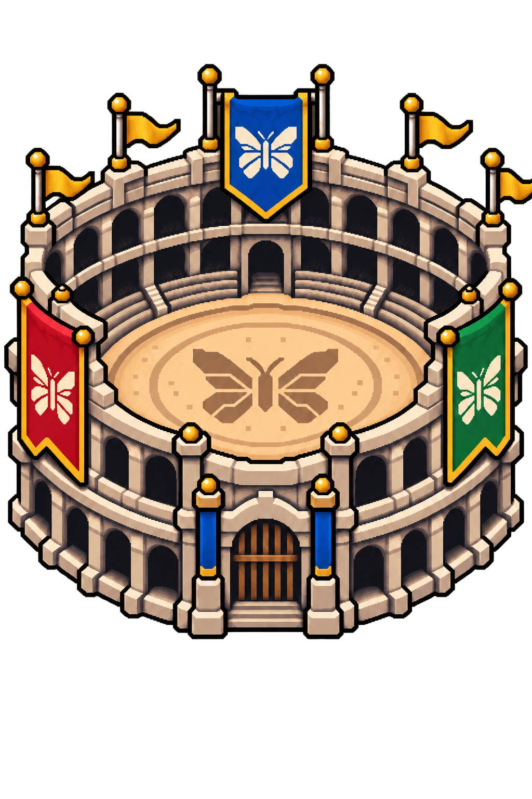

# Bslap: live Pokémon trades and battles

Included in the tested build **20261022**, awaiting publication. The currently
published v1.3.0 image does not include Bslap.

Bslap appears in the normal Tools menu alongside Blink and Bdex; Advanced Mode
is not required. Open **Tools → Bslap** to trade or battle between two ButterflyOS
devices on the same local network. Each player controls their own game. Blink remains the
separate save-editing tool; Bdex stores your collection outside the games.

## Supported games

- **Gen 1:** English Red, Blue and Yellow.
- **Gen 2:** English Gold, Silver and Crystal.
- **Gen 3:** English Ruby, Sapphire, Emerald, FireRed and LeafGreen.

Choose two games from the same generation. Gen 1/2 ROMs must match the English
revisions already qualified for Blink; Gen 3 is identified by its English game
header. Compressed ROMs, ROM hacks and other languages are not currently offered.
A valid ordinary `.srm` save must be beside each selected ROM. No ROMs, saves,
Pokémon graphics or extracted game data are included with ButterflyOS.

Gen 1 ↔ Gen 2 Time Capsule trading is not currently enabled. The original games
support cross-generation trades through the Time Capsule, but not battles.
Internet play and GB-Link/ESP32 hardware are outside the current feature.

## Host and join

1. Save and exit any running games. Connect both devices to the same local
   network. Guest Wi-Fi or client isolation can prevent discovery.
2. On one device, open **Tools → Bslap → Host**, choose **Gen 1**, **Gen 2** or
   **Gen 3**, then select the game. Read the save notice and choose **Ready**.
   Stay in the waiting lobby; the game stays closed.
3. On the other device, open **Bslap → Join**, select the host and a compatible
   game, read the notice and choose **Ready**.
4. When the host shows **Both Players Ready**, choose **Start** on the host.
   Both games launch automatically. Choose **Continue** to load the ordinary
   save, then use the upstairs Pokémon Center Cable Club for a trade or battle.
   Gen 3 uses the cable rooms, rather than the wireless Union Room.
5. Save normally in both games after finishing and leaving the room. For Gen 1/2,
   save on **both games before either player exits**. Exit both games with the
   normal emulator-exit hotkey to return to Bslap.

B cancels a waiting lobby. Hosting does not start a game before the other player
is ready and the host chooses Start. No passwords or ROM data are exchanged.

The games’ own requirements still apply: have enough party Pokémon, satisfy
story/Pokédex restrictions and avoid incompatible Pokémon or moves. A game
refusing an ineligible trade is different from a connection error.

## Gen 3 known issue: leaving the room

Gen 3 can show a communication error when leaving the Trade Center or Colosseum.
For better results, **let only one player initiate leaving**. On the other device,
respond to the exit dialogue that follows. Avoid independently starting the exit
sequence on both devices. This improves results but does not guarantee success.

An exit error does not prove a trade was saved or lost. Check the ordinary saves
after restarting. Keep backups of important saves.

**This warning applies to Gen 3 only.** Gen 1 and Gen 2 use a different link
implementation and passed user testing without this room-exit error or crashes.

## Saves, backups and recovery

Every session has a unique folder:

`/storage/.config/butterflyos/bslap/sessions/<session>/`

It contains `session.json`, `before.srm`, `after.srm` when available, configuration
and launch logs. Automatic save states are disabled; use normal in-game saves.

**Gen 3:** gpSP links the independent games directly. In-game saves update each
selected ROM’s adjacent `.srm`; Bslap preserves before/after copies.

**Gen 1/2:** SameBoy emulates both linked Game Boys on both devices, showing and
playing only the local player’s screen and audio. Both selected ROMs must already
exist on both devices. Only temporary save copies cross the LAN, authenticated
with a per-session token. Each original save stays untouched during play. After
a clean emulator exit, the local player’s validated result is copied back to its
original path, unless that original changed independently. Failed or conflicting
results stay in the session folder for recovery. Each device keeps both working
saves under `content/`; the host owns `player1.srm`, and the joining player owns
`player2.srm` (the joiner’s updated copy can be under `content/.netplay/`).
Existing Gambatte RTC trailers are retained. SameBoy RTC files stay in the test
session; clock persistence across cores has not been fully qualified.

To restore the original backup:

1. Exit both games and Bslap.
2. Copy the current ordinary save somewhere safe.
3. Read the original save path in `session.json` and copy that session’s
   `before.srm` back to that exact path.
4. Open the game and choose Continue, rather than loading an older state.

For a failed Gen 1/2 session, preserve the entire folder before attempting
recovery. Do not copy the other player’s working save over your own.

## Validation and implementation

User testing passed Gen 1 and Gen 2 trades/battles and the tested Gen 3 game pairs,
including Ruby/Sapphire/Emerald, FireRed/LeafGreen, and FireRed or LeafGreen with
Emerald. This is not an exhaustive every-game, every-host-role matrix. The Gen 3
room-exit limitation remains. Final-image testing is separate from live staging.

Bslap packages its dedicated ARM32 RetroArch/gpSP pair separately from normal
emulator defaults and uses the existing native RetroArch/SameBoy pair for Gen 1/2.
Installed hashes are checked against `/usr/share/bslap/backend.json`.
Local discovery uses UDP 55436; lobby readiness uses TCP 55437; gameplay uses
55435, with a temporary Gen 1/2 save exchange on TCP 55438.

Build inputs and reproduction notes are in
[the backend build guide](../tools/bslap/README.md).
