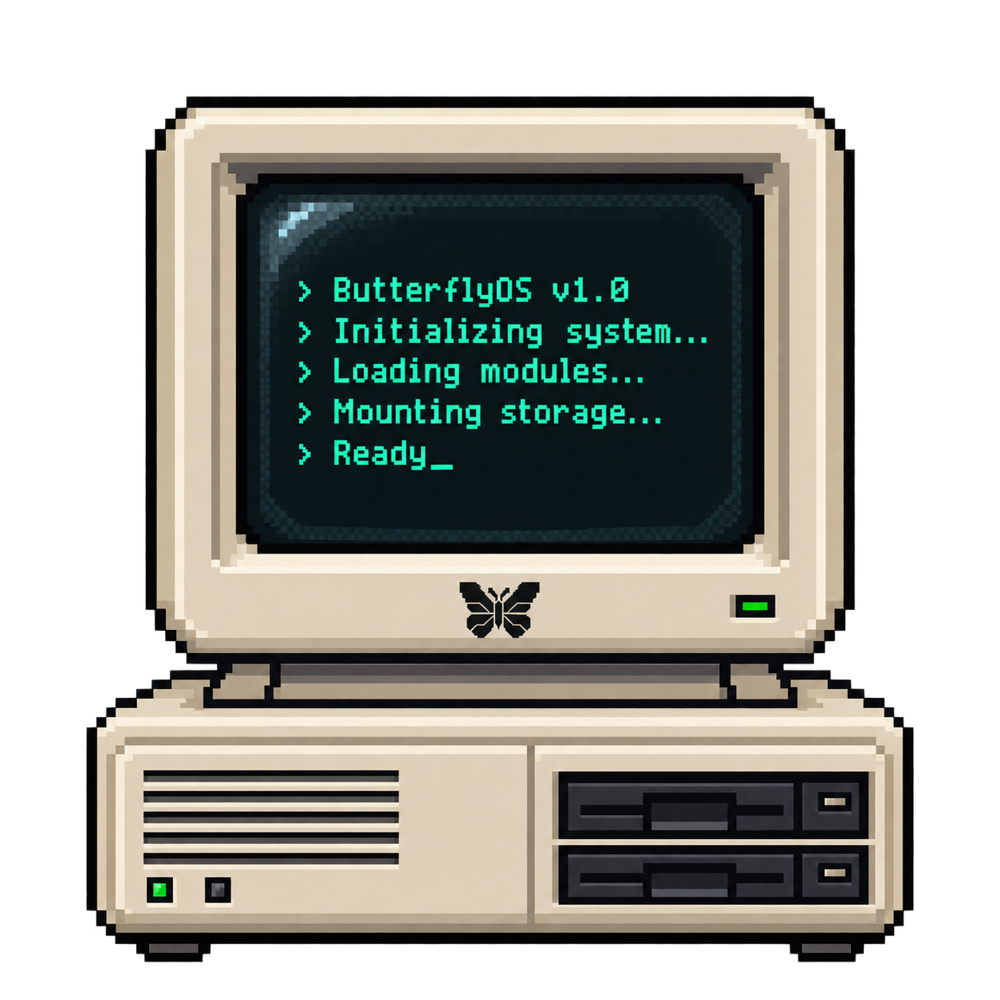
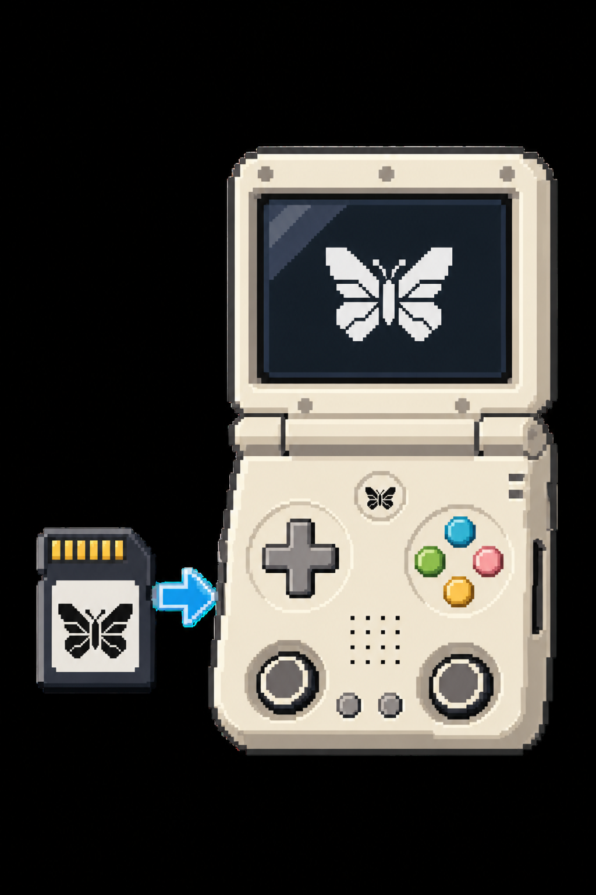
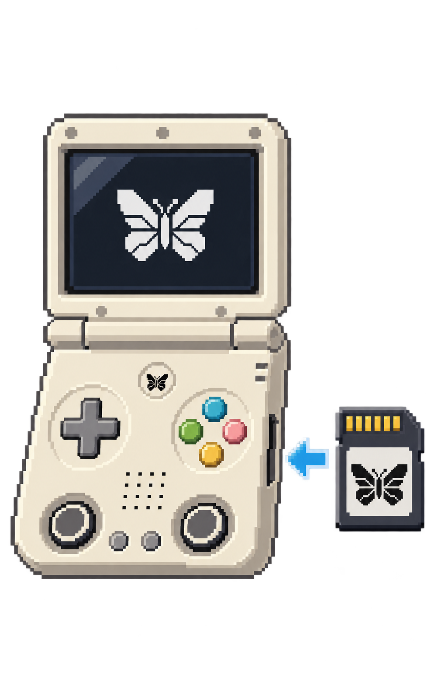

# ButterflyOS installation and recovery

**ButterflyOS will not start?** Begin with
[Boot troubleshooting and recovery](#boot-troubleshooting-and-recovery) below.

**ATTENTION**

Your Miyoo Flip V2 comes with Miyoo's original operating system installed inside the
console. A small startup program, called the **bootloader** (or **preloader**),
tells it where to find the system when you turn it on.

To let it start ButterflyOS from an SD card, ButterflyOS Setup makes a small
change to that startup program. It keeps the original Miyoo operating system installed:
with the ButterflyOS card removed, the console can still start Miyoo's operating system.

**Before making that change, Setup saves a copy of your device's original
preloader and a checksum.** The checksum lets the recovery tool check that the
backup is intact. This backup is what lets you undo the change and return to
stock Miyoo boot behavior. Installation and restoring the original preloader
have been tested on real Flip V2 devices, using their verified backups.


**Do not skip exporting your recovery backup.** After your first ButterflyOS
boot, open **Tools → Export Recovery Backup** and follow the download steps
below. Keep both the exported archive and its `.sha256` checksum on your PC or
another safe drive. A copy left only on the SD card can be lost if that card
fails or is formatted. Keep each device's backup clearly labeled.


If you want to undo the setup, **Tools → Restore Stock Miyoo Boot** uses your
verified original backup. **Keep that backup even if everything works today—
it is your way back if you need recovery later.**

**Switching to another operating system?** It may work with the ButterflyOS
preloader change still installed, but another OS may expect the original Miyoo
preloader. We strongly recommend using **Tools → Restore Stock Miyoo Boot**
before switching away from ButterflyOS, then following the new operating
system's installation instructions.

ButterflyOS aims to require no disassembly during normal installation or
removal. Opening the Miyoo Flip and pressing its MASKROM button is a last-resort
recovery method, not an onboarding step.

This guide applies only to the **Miyoo Flip V2**. Use the current device-specific
image and its matching checksum from the
[latest stable release](https://github.com/KeatenPerkins/butterflyOS/releases/latest); see
[current build status](CURRENT_BUILD_STATUS.md).

Installation changes the internal preloader even though the OS runs from SD.
Stock system partitions are preserved; this is not a zero-write installation.
Exact reversal requires the backup from this particular device.

## Already installed ButterflyOS before?

**The bootloader setup is normally needed only once per device.** Downloading
and flashing a newer ButterflyOS image does not undo the bootloader change.
If this Flip already booted ButterflyOS and you have not restored its original
Miyoo bootloader, **skip the left-hand-slot Setup process below**.

- To update an existing installation, use **Start → System Settings → Update
  ButterflyOS**. See the [update guide](UPDATES.md).
- To start again with a freshly flashed card, fully power off, put the new OS
  card in the **right-hand slot**, and turn the device on. Flashing erases the
  card, so first copy your games, saves, and exported recovery backup somewhere
  safe. See [Export the recovery backup before reflashing](#export-the-recovery-backup-before-reflashing).
- If you used **Restore Stock Miyoo Boot** since your last installation, follow
  the first-time setup below again.

If Setup returns to the stock Apps menu without shutting down, do not assume
it completed or keep repeating it. An existing bootloader change or a failed
check may explain this. Note any message shown and ask for help if the freshly
flashed card will not boot from the right-hand slot. Keep your original
device-specific recovery backup; reflashing does not create a new original.

## First-time installation



1. Write the device-specific ButterflyOS image to a microSD card.
2. Leave the original Miyoo system installed internally. Put the ButterflyOS
   card in the **left-hand slot**, then start the stock Miyoo system.

   

   *First installation: left-hand slot, viewed from the front of the device.*

3. Open **Apps**, then open **ButterflyOS Setup**.
4. The first launch performs a read-only compatibility check, derives a patch
   from this unit's own preloader, and saves an exact verified backup to
   `butterflyos-recovery/` on the card. It does not write internal storage.
5. Open **ButterflyOS Setup** a second time within five minutes. The installer
   repeats every check, patches only the SPL device tree, verifies the write by
   reading it back, and powers off. Do not remove power or the card while it is
   working.
6. After shutdown, move the ButterflyOS card from the left-hand slot to the
   **right-hand slot**, then power on. The prepared card boots ButterflyOS.

   

   *Boot ButterflyOS: right-hand slot, viewed from the front of the device.*

7. In ButterflyOS, open **Tools → ButterflyOS Boot Check**. This is read-only.
8. Open **Tools → Export Recovery Backup**. In Web File Transfer,
   open **All Storage** and download both `ButterflyOS-Recovery-*.tar.gz` and
  its matching `.sha256` file to another computer or drive.

Tools is available on the home screen and through Start. Keep the device
adequately charged and use the front charging port if external power is needed.
Normal onboarding does not require a USB connection to a computer.

### If the card or Setup app is not detected

Both qualification devices occasionally failed to detect a correctly prepared
card on the first stock-OS boot, or did not show **ButterflyOS Setup** during
the first Apps scan. This did not indicate a bad image. If it happens:

1. Shut down normally through the stock OS and wait until the device is fully
   off. Never remove or reseat the card while the device is powered on.
2. Remove and firmly reseat the card in the **left-hand slot**.
3. Power on again and reopen **Apps**.
4. If Setup remains absent, repeat one normal shutdown, reseat, and cold boot.

Do not proceed if the card remains intermittent after reseating. Test the card
and use a known-good microSD card before allowing Setup to write the preloader.

The finished behavior is:

| State at power-on | Result |
|---|---|
| Compatible ButterflyOS card inserted | ButterflyOS boots from microSD |
| Card removed | Internal stock Miyoo system boots |

The installer verifies the board and SoC, exact MTD identity and size, NAND
geometry, battery or charger state, both IDB copies, and all four embedded
SHA-256 values. It verifies that DDR firmware and SPL executable code remain
unchanged, saves the device's exact original preloader and checksum before any
erase, verifies readback, retries, and restores the original after failure.
Unknown, damaged, and already-modified structures are refused.
The first public Alpha additionally uses an explicit SHA-256 allowlist of stock
preloader revisions qualified on real hardware. A structurally valid but new
revision is reported for review and is not written automatically.

The bootstrap is deliberately not automatic. It requires two separately
launched confirmations from stock within five minutes. The first launch writes
nothing internally. The second launch performs the persistent change.

## Slot summary

| Part of setup | Slot |
|---|---|
| Run **ButterflyOS Setup** from stock Apps | Left-hand slot |
| Boot and use ButterflyOS | Right-hand slot |
| Boot the stock Miyoo system after setup | Remove the ButterflyOS card |
| Optional games/media card while ButterflyOS is running | Left-hand slot |

Power off fully before moving cards. Only the OS card is imaged with ButterflyOS;
the optional game card is normally exFAT and must not be selected accidentally
when writing an OS image.

## Returning to stock boot


The stock-side installer creates these files on the ButterflyOS FAT boot
partition before changing internal storage. ButterflyOS mounts that partition
at `/flash`:

```text
butterflyos-recovery/preloader-original.img
butterflyos-recovery/preloader-original.img.sha256
```

The image must be exactly 2 MiB. The checksum file begins with its 64-character
SHA-256 value, in the same format produced by `sha256sum`. If both files are
present and valid, ButterflyOS labels the restore source **EXACT DEVICE
BACKUP**, displays its verified hash, and passes that explicit image to the
low-level restoration utility.

If either file is missing, the size is wrong, or the checksum differs,
restoration stops without writing. There is no generic fallback image.

While ButterflyOS still boots, open
**Tools → Restore Stock Miyoo Boot** and confirm. The utility validates the
selected image, proves that the installed preloader is the patch derived from
that original, writes the exact original, and verifies its readback. ButterflyOS
SD multiboot is then disabled and the
internal Miyoo system boots normally.

Restore is therefore byte-for-byte identical to what that specific device held
before installation. Without the verified device-specific pair, ButterflyOS
refuses to restore.

## Export the recovery backup before reflashing


The recovery pair initially lives on the ButterflyOS boot partition. Writing a
new whole-card image erases that partition, the storage partition, and every
copy stored on that microSD card.

Open **Tools → Export Recovery Backup**. The tool revalidates the
backup's size and SHA-256 before creating these files at the top of **All
Storage**:

```text
ButterflyOS-Recovery-<device-hash>.tar.gz
ButterflyOS-Recovery-<device-hash>.tar.gz.sha256
```

Download both files to a different physical device. Keeping the archive only
on the ButterflyOS card does not protect it from a reflash. The archive is
specific to the Miyoo Flip that created it; do not publish it, share it, or use
it on another unit.

After reflashing, verify and extract the archive on a computer. Copy the
extracted `butterflyos-recovery` folder to the root of the `BUTTERFLYOS` boot
partition. **Restore Stock Miyoo Boot** will independently check the 2 MiB
image and its SHA-256 manifest before allowing a restore.

The export protects the preloader recovery files, not your games, saves, media,
or settings. Back those up separately. If SD boot remains enabled after a
reflash, put the rewritten OS card in the right slot and boot it; the stock-side
setup does not need to be rerun. Never substitute another unit's recovery archive.

## Boot troubleshooting and recovery

### ButterflyOS does not boot, but Miyoo's stock operating system does

A device that still starts the stock operating system is not necessarily
bricked. Start with the card and installer checks:

1. Fully shut down before moving cards. The ButterflyOS OS card goes in the
   **right-hand slot**, viewed from the front. The left-hand slot is used for
   first-time Setup and, afterward, an optional games card.
2. If this device already ran ButterflyOS and its original bootloader has not
   been restored or replaced since, do not repeat bootloader installation just
   because you flashed a newer image. See
   [Already installed ButterflyOS before?](#already-installed-butterflyos-before).
3. If Setup stops or returns to Apps unexpectedly, collect its logs before
   restoring internal firmware or repeatedly reflashing the card. Back up the
   card's games, saves, and recovery files before any reflash.

**Previously used another OS?** Its setup may have changed the internal
bootloader. For example, [KNULLI's Flip preparation instructions](https://knulli.org/devices/miyoo/flip/)
use GammaLoader. ButterflyOS Setup checks for a qualified stock preloader and
can refuse an unknown or modified one. A custom splash picture alone does not
prove the preloader changed. The installer log identifies which check failed;
do not bypass the check or assume every other OS needs full recovery.

### Collect Setup logs on Windows

The stock-side app is **Apps → ButterflyOS Setup**, not the Boot Check tool
inside ButterflyOS. To collect a read-only compatibility check:

1. Wait **more than five minutes since the last Setup launch**. A second launch
   within five minutes after a successful first check confirms installation.
2. With the prepared card in the **left-hand slot**, open **ButterflyOS Setup
   once** from stock Apps. Let it finish and do not open it a second time.
3. Shut down normally, then put the card into your Windows PC.
4. Open **File Explorer → This PC → BUTTERFLYOS**. If Windows offers to format
   another partition, choose **Cancel**; Windows cannot normally read the
   card's Linux storage partition.
5. Copy these files and include them with your support request:

   - **App → ButterflyOS_Setup → setup-last.log**
   - **butterflyos-recovery → install-last.log**

If only one log exists, send that one. If neither exists, report that too.
Include the Flip revision and any other OS or bootloader installers previously
used. Keep recovery images private; these two text logs are what support needs
first. A successful first check does not mean installation has happened.

### ButterflyOS boots and you want to restore stock boot behavior

Use **Tools → Restore Stock Miyoo Boot** with this device's verified original
backup. See [Returning to stock boot](#returning-to-stock-boot). This is the
ButterflyOS restore path tested on local Flip V2 devices.

### Neither OS boots, or the original preloader backup is unavailable

Losing the backup file does not itself damage the installed bootloader. If
ButterflyOS still boots, check whether **Tools → Export Recovery Backup** can
export the original pair still on the card. It cannot recreate an original
that is no longer available.

### Try Miyoo's official firmware recovery first

**Before opening the device or using low-level recovery, check Miyoo's own
firmware downloads and recovery instructions.** Reinstalling stock firmware
from an SD card may resolve a stock-system or boot-image problem without
disassembly, especially when the stock operating system still starts.

1. Save any available Setup logs and recovery backups to your PC. Use a spare
   card so the ButterflyOS card and its files can be kept intact.
2. Open [Miyoo's firmware downloads](https://lomiyoo.com/pages/firmware) and find
   the **Miyoo Flip** section. The **Miyoo Mini Flip is a different device**.
3. Choose the firmware/reinstallation package appropriate to your Flip
   revision. Miyoo lists regular firmware, a package for devices unable to boot,
   and a stock SD-card file package; these serve different purposes. If unsure,
   confirm the choice with Miyoo support before proceeding.
4. Follow Miyoo's current instructions and the tutorial included in the
   package. Its SD-card firmware procedure uses a FAT32 card with the extracted
   `miyoo355_fw.img` copied to the card's top level. Copying that update file is
   different from writing a ButterflyOS whole-card image with Rufus. Follow the
   package's power/button instructions and do not interrupt power once flashing
   has started.
5. Miyoo also provides [boot troubleshooting and firmware reinstallation
   guidance](https://lomiyoo.com/pages/technical-solutions). If the procedure
   does not start or finish as described, ask for help before moving to a
   different firmware package or low-level recovery.

**A stock firmware reinstall is not necessarily a stock-preloader restore.**
The SD-card recovery image inspected during ButterflyOS development rewrites
U-Boot, the boot image, and the stock root filesystem, but not the SPL
preloader. We have not qualified this external recovery procedure as a way to
undo GammaLoader or every other bootloader modification. If stock starts again
but ButterflyOS Setup still refuses installation, collect its logs and request
review; do not bypass the preloader check or repeatedly reflash firmware.

### Low-level recovery when the firmware route is insufficient

For cases that require low-level recovery, the Spruce team maintains:

**[Miyoo Flip recovery guide — SpruceOS](https://github.com/spruceUI/spruceOS/wiki/16.-Miyoo-Flip-Unbricking)**

Thank you to the Spruce team for maintaining this resource and allowing us to
link to it. This is the low-level recovery route, rather than a required first
step whenever ButterflyOS will not boot. Their guide covers Windows drivers, RKDevTool, opening the device,
and entering Rockchip MASKROM mode to restore internal firmware. This is a
full firmware recovery procedure, not an SD-card reflash or a splash reset.

**Before proceeding, confirm with the guide's maintainers that its recovery
files support your exact Flip hardware revision.** ButterflyOS has not
qualified that external package across its supported hardware. Preserve any
existing backups, follow the current external instructions, and do not
substitute another device's ButterflyOS preloader backup.

After restoring stock firmware, first verify that Miyoo's stock operating
system boots without the ButterflyOS card. Then follow
[First-time installation](#first-time-installation) again. ButterflyOS Setup
will repeat its checks; a firmware restore does not guarantee its preloader
revision is one ButterflyOS currently accepts. If it refuses, collect the logs
above and request review instead of repeating the restore.

## Recovery if installation is interrupted

The installer keeps both original and derived images in RAM and retries a
failed write three times. If patched readback cannot be verified, it writes the
exact original back and verifies that readback. An interruption during the
brief erase/write window may still require RK3566 USB MASKROM recovery. If USB
MASKROM is not detected automatically, opening the shell and using the internal
MASKROM button remains the final recovery path.

The immutable SoC bootrom and MASKROM implementation are not stored in the SPI
NAND region modified by ButterflyOS.

A development recovery experiment also proved that ButterflyOS can read and
verify the complete internal NAND and can constrain a repair to an exact MTD
region. Full-NAND backup/restore is not exposed in Alpha 2; it remains a future
Advanced feature because interruption, bad-block handling, and device-specific
stock data require additional safeguards.

## Public-release gates

Do not describe onboarding as generally supported until all of these have been
tested on physical hardware:

- The stock launcher discovers `App/ButterflyOS_Setup` on the ButterflyOS boot
  partition.
- The first launch passes its full dry run, saves an exact verified backup, and
  writes nothing internally.
- The second launch derives, writes, and verifies the device-local patch.
- The read-only ButterflyOS Boot Check passes.
- Stock boots with the card removed.
- ButterflyOS boots with the card inserted.
- Restore Stock Miyoo Boot verifies successfully.
- Stock and SurwishOS boot after restoration.
- A second software-only ButterflyOS installation succeeds.

The complete round trip passed on the primary ButterflyOS Flip V2 test unit on
2026-09-01. On 2026-09-10, a second previously untouched Flip V2 completed the
device-local install, ButterflyOS/card boot, stock/no-card boot, exact restore,
and stock/card boot sequence. Independent readback after restoration matched
that unit's archived factory backup byte-for-byte. See
[`ALPHA2_ONBOARDING_QUALIFICATION.md`](ALPHA2_ONBOARDING_QUALIFICATION.md).

Qualification exposed two missing runtime interfaces. Both operations refused
before writing, and permanent fixes were package-tested. The clean rebuilt
image containing those fixes subsequently completed the same sequence without
live intervention.

## Third-party release note

The device-tree patch algorithm is derived from apommel's BaseOS implementation
and retains its MIT copyright and permission notice. ButterflyOS ships the
patch description and safety scripts, but no stock or prepatched Miyoo
preloader image. The Alpha 1 image remains an internal artifact; the clean
device-local workflow has passed physical Alpha 2 qualification.
